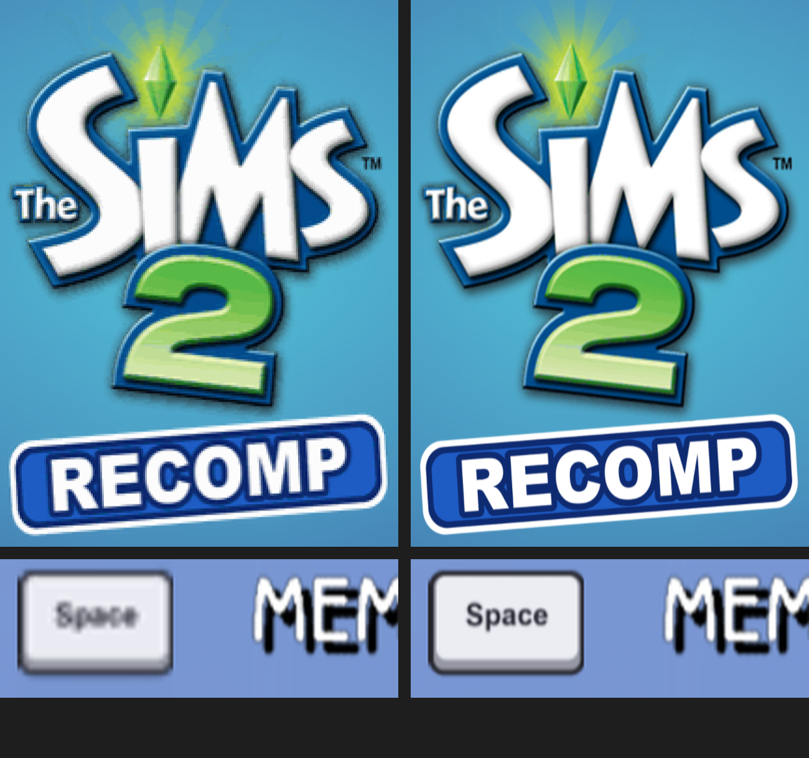

# S2Recomp

A native PC port of **The Sims 2** for PlayStation 2 (PAL, `SLES-53718`), made by statically recompiling the
game's PS2 code into C++ with [PS2Recomp](https://github.com/ran-j/PS2Recomp). No emulator: the game's
MIPS code becomes a regular Windows/Linux program, with a PS2 hardware layer (GS, VU1, VIF, IOP, SPU2,
memory cards, pads) running alongside it.



> **You need your own copy of the game.** This repository contains no game data and no game code.
> The recompiler runs on *your* disc image on *your* PC and builds the game there.
> S2Recomp is a fan project and is not affiliated with or endorsed by Electronic Arts or Maxis.

**Community:** news, help and co-op partners on the [S2Recomp Discord](https://discord.com/invite/YwAx7DrrFY).

## Features

- **Full speed, natively** – runs the game at its intended speed on a modern PC; no emulator in the loop.
- **GPU renderer** (OpenGL 3.3) with **internal resolution up to 4×** (2560 × 2048, from the PS2's 640 × 512). A bit-exact CPU
  renderer is kept as the reference.
- **HD texture packs** and texture replacement (dump a texture, edit it, drop it in a mod folder).
- **Frame generation** – the game's 30 FPS shown as ~60 FPS with motion-compensated in-between frames.
- **Launcher** – resolution, graphics, audio, controls, co-op and mods in one place, fully usable with a
  controller. It also tells you when a new version is out and updates in one click.
- **Controllers and keyboard/mouse** – Xbox, PlayStation and keyboard button prompts in game, following
  the last device you used. Rumble supported.
- **Online co-op** – play two-player with a friend over the internet, set up
  from the launcher with a short join code.
- **Multiple save slots** – the PS2 game keeps one save per memory card; here it asks which slot to
  load from or save to, so you can keep as many saves as you like.
- **Mods** – file replacements, texture packs and code mods (C/C++ DLLs with an SDK). Comes with:
  - **PerformanceHUD** – FPS overlay
  - **MemoryTools** – search, set and freeze values in the game's memory
  - **HelloMod** – a starting point for writing your own code mod
- **Windows and Linux** (including Steam Deck / SteamOS).

## Installing (players)

Download the installer for your system from the [Releases](../../releases) page.

**Windows:** run `S2Recomp-<version>-windows-x64-setup.exe`. Setup will:
1. ask for your disc image (`.iso`) and check that it is the right version (`SLES_537.18`);
2. make sure Microsoft's C++ build tools are installed (it asks before installing anything);
3. build the game on your PC – about 30 minutes on a fast machine.

**Linux / Steam Deck:** run `S2Recomp-<version>-linux-x86_64.run` (make it executable first, or
`sh S2Recomp-<version>-linux-x86_64.run`). A setup window asks for your disc image and can add the game
to Steam. It installs per-user, picks up your distro's packages (or uses a podman/docker container on
SteamOS and immutable distros), then builds the game. Expect a few hours on a Steam Deck.

Then start **S2Recomp** from the Start menu / app launcher.

### Updating

The launcher checks GitHub for a new release when it starts. If there is one, it says so at the bottom
of the window and the **Build** button becomes **Update**: click it, and the launcher downloads the new
installer and runs it. Your disc image, saves, settings and mods are kept, and only the parts of the game
that changed are rebuilt. You can also download the new installer from [Releases](../../releases) and
run it over your current install.

## Online co-op

Open the launcher's **Co-op** tab:

1. **Host:** choose *Host* and press Play. The first time, the game saves your join code (it looks like
   `EOSS-DK18` and stays the same on this PC); copy it and send it to your friend.
2. **Join:** choose *Join*, paste the host's code and press Play.

Both players need the same S2Recomp version and the same **input delay** (raise it if the game stutters
on a slow connection).

## Controls

| Key | What it does |
| --- | --- |
| F1 | Debug panel |
| F2 | Mods menu (settings of the code mods that are on) |
| F8 | FPS overlay (PerformanceHUD) |

Pad and keyboard bindings are set in the launcher's **Audio & Input** tab.

## Mods

Each mod is a folder in `mods/` next to the game executable, with a `mod.ini`:

```ini
name = My Mod
version = 1.0
author = You
description = What it changes
enabled = true
priority = 0
```

A mod folder can contain any mix of:

| Path | What it does |
| --- | --- |
| `files/...` | Replaces or adds disc files, laid out like the disc (`files/DATA/FONTS.ARC`) |
| `textures/` | Texture replacements (`<hash>_<w>x<h>_<psm>.bin` + optional HD `.png`) |
| `mod.dll` | A code mod that runs inside the game |

Turn mods on and off in the launcher's **Mods** tab (or with `MODS.bat`). Higher priority loads later and wins.
Set `PS2X_TEX_DUMP=<folder>` to dump the game's textures. The full guide is
[`PS2Recomp/ps2xRuntime/mods/README.txt`](PS2Recomp/ps2xRuntime/mods/README.txt).

## Source code

The full source is in this repository, so you can check what the installers and the game do:

| Folder | What it is |
| --- | --- |
| [`PS2Recomp/ps2xRuntime`](PS2Recomp/ps2xRuntime) | The runtime the game runs on: memory, threads, graphics, sound, input, co-op, mods |
| [`PS2Recomp/ps2xRuntime/launcher`](PS2Recomp/ps2xRuntime/launcher) | The launcher: settings, mods, co-op and the update check |
| [`PS2Recomp/ps2xRecomp`](PS2Recomp/ps2xRecomp) | The recompiler that turns the game's code into C++ on your PC |
| [`PS2Recomp/ps2xIOP`](PS2Recomp/ps2xIOP) | The PS2's I/O processor side |
| [`PS2Recomp/installer`](PS2Recomp/installer) | The Windows setup and the Linux `.run` setup window and scripts |
| `sims2_config.toml`, `vu1_locations.toml` | The game's recompiler settings (no game code) |

There are no game files or game code here or in the installers: the game is built on your PC from your
own disc. The SHA-256 checksum of each installer is listed in its release notes, so you can check that
your download matches. Third-party licenses are in [THIRD_PARTY_NOTICES.md](THIRD_PARTY_NOTICES.md).

## Building from source (developers)

### Requirements

- Windows: Visual Studio 2022 or newer with **Desktop development with C++** (MSVC or clang-cl)
- Linux: clang or gcc with C++20, CMake 3.20+, Ninja, X11 development headers
- A CPU with SSE4.1; a GPU with OpenGL 3.3 for the GPU renderer
- Your disc image, extracted into `extracted/` (the main executable is `extracted/SLES_537.18`)

### Windows

From a **Developer PowerShell for VS** in the project folder (your disc extracted into `extracted\`):

```powershell
# 1. Build the tools and recompile the game's code into PS2Recomp\ps2xRuntime\src\runner\
cmake -S PS2Recomp -B PS2Recomp\build_win
cmake --build PS2Recomp\build_win --config Release --target ps2_recomp ps2xVuGen
PS2Recomp\build_win\ps2xRecomp\Release\ps2_recomp.exe sims2_config.toml
copy output\ps2_recompiled_*.h PS2Recomp\ps2xRuntime\include\
mkdir PS2Recomp\ps2xRuntime\src\runner; copy output\*.cpp PS2Recomp\ps2xRuntime\src\runner\

# 2. Compile the VU1 programs (optional: without them the VU1 interpreter runs everything)
PS2Recomp\build_win\ps2xRuntime\Release\ps2xVuGen.exe vu1_locations.toml extracted PS2Recomp\ps2xRuntime\src\lib\vu\vu1gen

# 3. Build the game and the launcher
cmake -S PS2Recomp -B PS2Recomp\build_win
cmake --build PS2Recomp\build_win --config Release --target ps2EntryRunner S2RecompLauncher
```

Then:

| Script | What it does |
| --- | --- |
| `LAUNCHER.bat` | Opens the launcher |
| `MODS.bat` | Mod manager in the console |

Release builds use LTO, so the final link
is slow; for quick iteration build `RelWithDebInfo`.

### Linux

```bash
cmake -S PS2Recomp -B build -G Ninja -DCMAKE_BUILD_TYPE=Release \
  -DCMAKE_C_COMPILER=clang -DCMAKE_CXX_COMPILER=clang++ \
  -DCMAKE_C_FLAGS=-march=x86-64-v2 -DCMAKE_CXX_FLAGS=-march=x86-64-v2
cmake --build build --target ps2EntryRunner
./build/ps2xRuntime/ps2EntryRunner extracted/SLES_537.18
```

`-march=x86-64-v2` (or `-msse4.1`) is required with clang/gcc.

## How it works

```
disc image ──extract──► SLES_537.18 (main ELF) + game data
SLES_537.18 ──ps2xAnalyzer──► sims2_config.toml   (functions, stubs, jump tables)
config + ELF ──ps2xRecomp──► one C++ file per guest function (~13,000)
VU1 programs ──ps2xVuGen──► compiled VU1 microprograms (interpreter as fallback)
generated code + ps2xRuntime ──CMake──► ps2EntryRunner (the game)
```

| Folder / file | What it is |
| --- | --- |
| `PS2Recomp/ps2xRecomp` | The recompiler: R5900 (EE) MIPS → C++ |
| `PS2Recomp/ps2xAnalyzer` | Scans the ELF and writes the TOML config (from upstream PS2Recomp, not in this repository) |
| `PS2Recomp/ps2xRuntime` | Runtime: memory, threads, syscalls, GS/VU/VIF/SPU2, renderer, frame gen, mod loader, launcher |
| `PS2Recomp/ps2xIOP` | IOP (R3000A) side: IRX modules and HLE |
| `PS2Recomp/installer` | Windows (Inno Setup) and Linux installers |
| `sims2_config.toml` | The game's recompiler config |
| `vu1_locations.toml` | Where each compiled VU1 program's code lies in `SLES_537.18` (no code) |

## Credits

- [PS2Recomp](https://github.com/ran-j/PS2Recomp) by ran-j and contributors – the static recompiler this
  project is built on
- [raylib](https://www.raylib.com/), [Dear ImGui](https://github.com/ocornut/imgui),
  [rlImGui](https://github.com/raylib-extras/rlImGui), [SDL2](https://www.libsdl.org/),
  [FFmpeg](https://ffmpeg.org/)

## License

GPL-3.0, same as PS2Recomp – see [`PS2Recomp/LICENSE`](PS2Recomp/LICENSE).
The Sims 2 is a trademark of Electronic Arts Inc. No game assets or code are distributed.
